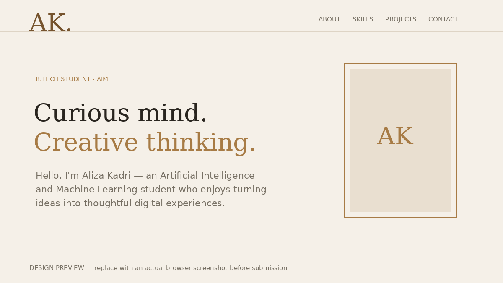

# Aliza Kadri — Personal Portfolio

A responsive, luxury-inspired personal portfolio website for Aliza Kadri, a second-year B.Tech student in Artificial Intelligence and Machine Learning.

## Technologies used
- HTML5 for page structure and semantic sections
- CSS3 for styling, responsive layout, hover effects and theme colours
- JavaScript for the mobile navigation, dark mode and contact form validation

## Run locally
1. Download or clone this repository.
2. Keep `index.html`, `style.css`, `script.js` and `profile.jpg` in the same folder.
3. Add your own portrait image and name it `profile.jpg`.
4. Open `index.html` in a browser.

## Personalise before submitting
- Replace `profile.jpg` with your own photo.
- Replace `aliza.kadri@example.com` with an email address you are comfortable sharing, or remove that line.
- Check that the project descriptions accurately match the work you have done.
- Add links to your own project repositories if available.

## Screenshot
Add a screenshot of your website here after opening `index.html` in your browser. Save it as `screenshot.png` in this folder, then uncomment the line below:

<!--  -->

## GitHub Pages
After pushing the project to GitHub, open **Settings → Pages**, choose the `main` branch and `/ (root)` folder, then save. GitHub will provide your live website URL.

## Author
Aliza Kadri  
B.Tech — Artificial Intelligence and Machine Learning  
Roll No.: 267509
